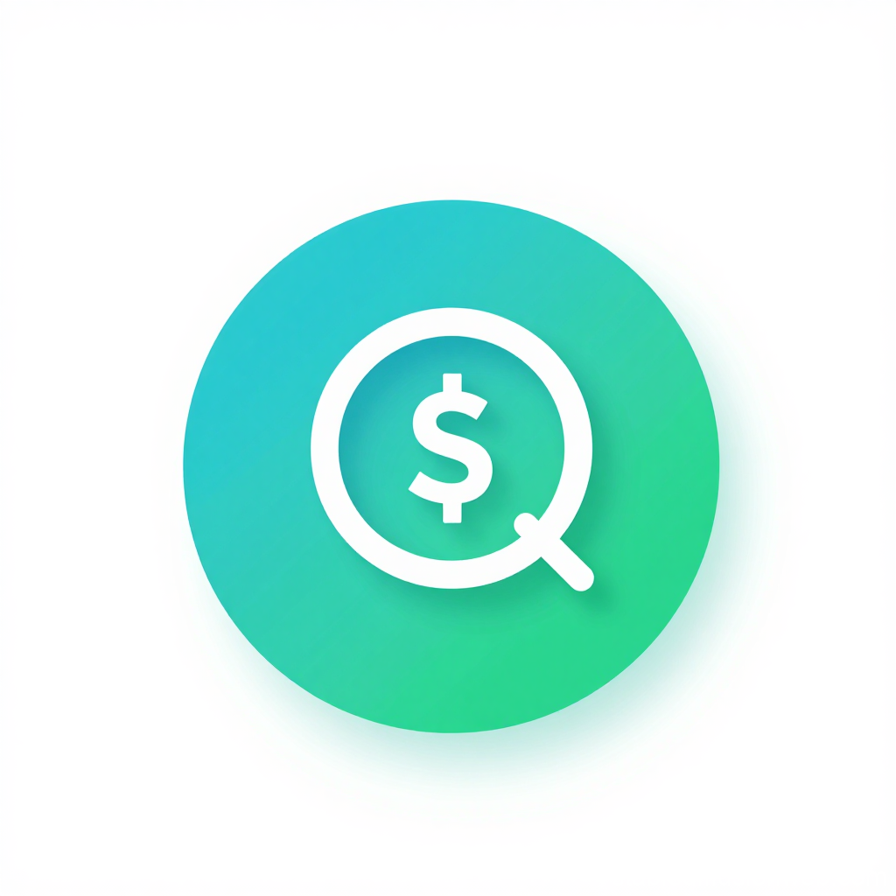

<div align="center">



# Expense Tracker Web Application

**VEDA TECHNOLOGY INTERNSHIP — DAY 41**


</div>

---

## Project Overview

**Expense Tracker** is a fully functional, client-side financial application built with **HTML5, CSS3, and Vanilla JavaScript**. It lets users record, view, edit, delete, filter, sort, and analyze personal expenses. All data is persisted in the browser using **LocalStorage**, so expenses survive page refreshes and browser restarts. No backend, no frameworks, no build step.


## Features

- **Dashboard** with four live statistics: Total Expenses, Transaction Count, This Month spending, and Average Expense per transaction.
- **Spending by Category** breakdown with progress bars and percentages.
- **Add Expense** form with Title, Amount, Category, Date, and Description.
- **Edit & Delete** any transaction, with a confirmation modal for deletion.
- **Category filtering** — view expenses for a single category or all.
- **Date range filtering** — filter by "from" and "to" dates.
- **Search** across title, category, and description.
- **Sorting** by date (newest/oldest), amount (high/low), and title (A–Z / Z–A).
- **Automatic total calculation** across all views.
- **LocalStorage persistence** — expenses are saved and restored automatically.
- **Form validation** with inline error messages and safe handling of user input (XSS-safe rendering).
- **Responsive** layout for desktop, tablet, and mobile (down to 320px).
- **Toast notifications** for add / update / delete / error feedback.
- **Accessible** markup (ARIA labels, live regions, keyboard support).

## Technologies

| Technology | Use |
|---|---|
| HTML5 | Semantic structure, forms, ARIA attributes (`index.html`) |
| CSS3 | Custom properties, Flexbox, Grid, responsive media queries (`style.css`) |
| JavaScript (ES6+) | State management, DOM manipulation, LocalStorage (`script.js`) |
| SVG | Favicon (`assets/favicon.svg`) |
| LocalStorage | Client-side persistence of expenses |
| No frameworks | Zero dependencies |

## Project Structure

```text
internship-task-41/
├── index.html          # Application markup
├── style.css           # Responsive styling (light theme, blue accents)
├── script.js           # Application logic
├── README.md           # This file
└── assets/
    └── favicon.svg     # App favicon
```

## Installation

No installation or build step is required.

1. Download or clone the project folder.
2. Open the `internship-task-41` folder.

## How to Use

1. Open `index.html` in any modern browser (Chrome, Edge, Firefox, Safari).
2. Or serve locally: `python -m http.server 8000` then visit `http://localhost:8000`.
3. Or use VS Code **Live Server**: right-click `index.html` → **Open with Live Server**.

### Using the app

- **Dashboard** — view totals, transaction count, monthly spending, average, and category breakdown.
- **Add Expense** — fill Title, Amount, Category, Date, optional Description, then click **Add Expense**.
- **Edit** — click **Edit** on any transaction; the form populates and the button becomes **Update Expense**. Click **Cancel Edit** to abort.
- **Delete** — click **Delete** and confirm in the dialog.
- **Filter** — use Category, From/To dates, and Search. Combine freely.
- **Sort** — choose from the Sort By dropdown.
- **Clear Filters** — resets all filters and search.
- **Reset** (form) — clears the form fields.

All changes are saved automatically to LocalStorage.

## LocalStorage Implementation

- **Key:** `veda_expense_tracker_v1`
- **Value:** JSON array of expense objects:
  ```json
  {
    "id": "uuid",
    "title": "Grocery shopping",
    "amount": 1250.50,
    "category": "Food",
    "date": "2026-11-19",
    "description": "Weekly groceries",
    "createdAt": 1732000000000
  }
  ```
- On load, `loadExpenses()` reads and validates each record; invalid records are discarded.
- On every add / edit / delete, `saveExpenses()` writes the updated array.
- Storage failures are caught and surfaced via a toast notification.
- No data leaves the device.


---

<div align="center">
<p><sub>Veda Technology Internship — Day 41: Interactive Expense Tracker Web Application — HTML5 · CSS3 · Vanilla JavaScript</sub></p>
</div>
